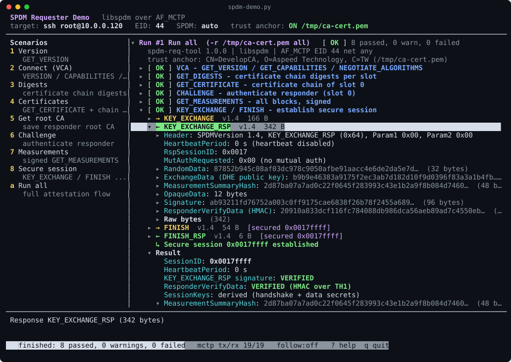

# spdm-req-tool

SPDM requester front-end for [DMTF libspdm](https://github.com/DMTF/libspdm),
talking to responders through the Linux kernel MCTP stack (`AF_MCTP`), plus
`spdm-demo`, an interactive TUI for demonstrations.

```
spdm-req-tool/
├── libspdm/                  git submodule (DMTF/libspdm, main)
├── src/                      spdm-req-tool (C)
│   ├── main.c                CLI and SPDM steps (version, connect, cert, ...)
│   ├── spdm_glue.c           libspdm context, AF_MCTP device I/O, transport tap
│   ├── mctp_io.c             AF_MCTP socket transport (routed or extended addressing)
│   ├── decode.c              human-readable decoder for every SPDM 1.0-1.4 message
│   ├── cert.c                X.509 / SPDM cert chain parsing, PEM/DER, root CA
│   ├── cbor.c                CBOR/COSE decoder (EAT measurement manifests)
│   └── output.c              colored text or JSON-lines output
├── demo/spdm-demo.py         curses TUI (Python stdlib only)
├── test/mctp_responder.c     libspdm test responder over AF_MCTP (sample keys!)
├── cmake/aarch64-linux-gnu.cmake
└── scripts/deploy.sh
```

## Build

```sh
git submodule update --init --recursive

# BMC (aarch64, statically linked, no runtime dependencies)
cmake -S . -B build-aarch64 -DCMAKE_TOOLCHAIN_FILE=$PWD/cmake/aarch64-linux-gnu.cmake
cmake --build build-aarch64 -j

# host (x86_64)
cmake -S . -B build-host && cmake --build build-host -j
```

libspdm is built as an ExternalProject (`CRYPTO=openssl`, Release, static).
It builds its bundled OpenSSL 3.5 (needed for ML-DSA), and the tool links the
static `libcrypto.a`. A clean build therefore takes a few minutes longer, and
the stripped aarch64 binary is about 5 MB. The link prints glibc warnings about
`dlopen`/`getaddrinfo` in a static binary. They are harmless: the tool never
reaches those OpenSSL code paths.
Options: `-DSPDM_STATIC=OFF`, `-DSPDM_TEST_RESPONDER=OFF`, `-DLIBSPDM_TARGET=Debug`.

Deploy to the BMC (`/tmp` by default):

```sh
BMC=root@10.0.0.120 BMC_PASS=0penBmc scripts/deploy.sh
```

## Usage

```
spdm-req-tool -e EID [options] COMMAND [COMMAND...]

  version | connect | digests | cert | get-root-ca | challenge | meas | session | all
```

Prerequisites run automatically (e.g. `challenge` performs VCA, GET_DIGESTS and
GET_CERTIFICATE first). Exit status is 0 when no step failed.

| Option | Meaning |
|---|---|
| `-e EID` | responder EID |
| `-n NET` | MCTP network (default any) |
| `-i IFNAME [-L LLADDR]` | bypass routing, send on the interface (extended addressing) |
| `-t MS` | minimum response timeout (default 3000) |
| `-V 1.x` | only negotiate this SPDM version |
| `--asym/--hash/--dhe/--aead LIST` | restrict algorithms, e.g. `--asym ecdsa-p384` |
| `--pqc-asym LIST` | SPDM 1.4 PQC algorithms (default `ml-dsa-44,ml-dsa-65,ml-dsa-87`), or `none` |
| `-s N` | certificate slot |
| `-m N\|all`, `--no-meas-sig` | measurement index / unsigned measurements |
| `--meas-summary none\|tcb\|all` | summary hash for CHALLENGE / KEY_EXCHANGE |
| `-r FILE` | **trusted root CA** (PEM/DER, repeatable): chain must anchor in it |
| `-R FILE` | where `get-root-ca` saves the responder's root CA |
| `-C FILE` | save the chain (PEM bundle, or raw SPDM chain if `*.bin`) |
| `-v` / `-vv` | **decode every SPDM request/response** (`-vv` adds MCTP frames) |
| `-x` | hex dump of every message |
| `-j` | JSON-lines output (consumed by spdm-demo) |
| `--color auto\|always\|never` | colored output (auto: only on a terminal, honours `NO_COLOR`) |
| `-q` | quiet: one line per step (and per loop round), no details; errors still go to stderr |
| `-l SEC`, `-c N`, `--loop-full` | loop mode (see below) |

### Root CA (certificate chain verification)

Without `-r` libspdm verifies the chain *integrity* (every signature, leaf
attributes, negotiated algorithms, the chain hash against DIGESTS), but the
chain is not anchored in anything you trust. The result is reported as **WARN**.

* `get-root-ca` extracts the self-signed root of the responder's chain and
  saves it (`-R file`, default `rootca-eid<E>-slot<N>.pem`), printing its
  subject and SHA-256 fingerprint. This is trust-on-first-use, so compare the fingerprint
  with one obtained out of band.
* `-r file` provisions trust anchors (`LIBSPDM_DATA_PEER_PUBLIC_ROOT_CERT`).
  The chain must then hash/chain to one of them, otherwise the step **FAILS**
  (`TrustAnchor: FAILED`).

```sh
spdm-req-tool -e 42 get-root-ca -R /tmp/ast1080-root.pem
spdm-req-tool -e 42 -r /tmp/ast1080-root.pem all
```

### Loop mode (fresh nonces every round)

```sh
spdm-req-tool -e 46 -r /tmp/ca-cert.pem --loop 5 challenge meas      # until Ctrl-C
spdm-req-tool -e 46 -r /tmp/ca-cert.pem --loop 5 --count 10 all
```

The commands repeat every `SEC` seconds. Each round:

* generates a new 32-byte requester nonce with libspdm's RNG for CHALLENGE and
  signed GET_MEASUREMENTS and passes it in explicitly (`requester_nonce_in`),
* checks that the nonce echoed in the request is the generated one, and that the
  **requester and responder nonces both differ from the previous round**. A
  repeated or all-zero responder nonce fails the step as a possible replay. For
  `session` the same check runs on the KEY_EXCHANGE / KEY_EXCHANGE_RSP random data,
* reports `NonceFreshness` in the step result and prints a per-round summary.

Later rounds reuse the connection and certificate chain (`all` then repeats
challenge, meas and session). `--loop-full` redoes VCA and GET_CERTIFICATE every
round. After a failed round the next one reconnects, so the loop recovers when
the device re-enumerates. Ctrl-C (or SIGTERM) stops after the current round, and a
second Ctrl-C exits immediately. The exit status is 1 if any round failed.

### Quiet output

`-q` is meant for scripts, logs and long loops:

```text
$ spdm-req-tool -e 46 -r /tmp/ca-cert.pem -q all
[  OK  ] connect      Negotiated SPDM 1.4
[  OK  ] digests      1 certificate slot(s) provisioned
[  OK  ] cert         Retrieved 5105-byte chain with 6 certificate(s), trusted
[  OK  ] challenge    Responder proved possession of the slot 0 private key (summary: all)
[  OK  ] meas         1 measurement block(s), signature verified
[  OK  ] session      Secure session 0x0026ffff established
[  OK  ] session-meas 1 measurement block(s)
[  OK  ] end-session  session closed

Summary: 8 passed, 0 warning, 0 failed

$ spdm-req-tool -e 46 -r /tmp/ca-cert.pem -q --loop 2 --count 3 challenge meas
[  OK  ] connect      Negotiated SPDM 1.4
[  OK  ] digests      1 certificate slot(s) provisioned
[  OK  ] cert         Retrieved 5105-byte chain with 6 certificate(s), trusted
[  OK  ] challenge    Responder proved possession of the slot 0 private key (summary: all)
[  OK  ] meas         1 measurement block(s), signature verified
[  OK  ] round 1      03:34:44  5 passed, 0 warning(s), 0 failed
[  OK  ] challenge    Responder proved possession of the slot 0 private key (summary: all)
[  OK  ] meas         1 measurement block(s), signature verified
[  OK  ] round 2      03:34:46  2 passed, 0 warning(s), 0 failed
[  OK  ] challenge    Responder proved possession of the slot 0 private key (summary: all)
[  OK  ] meas         1 measurement block(s), signature verified
[  OK  ] round 3      03:34:48  2 passed, 0 warning(s), 0 failed

Summary: 9 passed, 0 warning, 0 failed
```

### Human-readable traffic

`-v` prints every message as a decoded tree: header and description,
capabilities flag by flag, algorithm sets by name, digests, certificate
portions, chunking (`LargeResponse` / `CHUNK_GET`), CHALLENGE_AUTH fields,
measurement blocks (DMTF value types, device mode, SVN, CBOR/COSE/EAT
manifests decoded), KEY_EXCHANGE/FINISH, opaque data (secured message
versions) and ERROR codes. Messages inside a secure session are shown
decrypted and tagged `[secured session 0x...]`. Add `-x` for raw hex.

## Example output

Captured on the BMC against the AST1080 (EID 44) with the session-enabled firmware.

<details>
<summary><b>Full text output</b> of <code>spdm-req-tool -e 44 -r /tmp/ca-cert.pem all</code> (431 lines)</summary>

```text
$ /tmp/spdm-req-tool -e 44 -r /tmp/ca-cert.pem all; echo "exit status: $?"
spdm-req-tool 1.0.0 | libspdm | AF_MCTP EID 44 net any
    trust anchor: CN=DevelopCA, O=Aspeed Technology, C=TW (/tmp/ca-cert.pem)

==> VCA - GET_VERSION / GET_CAPABILITIES / NEGOTIATE_ALGORITHMS
    [  OK  ] Negotiated SPDM 1.4
      SPDMVersion: 1.4
      ResponderCTExponent: 20
      ResponderCapabilities: 0x000602d6
        CERT_CAP: Supports GET_DIGESTS and GET_CERTIFICATE
        CHAL_CAP: Supports CHALLENGE authentication
        MEAS_CAP: Measurements with signature
        ENCRYPT_CAP: Supports message encryption in sessions
        MAC_CAP: Supports message authentication in sessions
        KEY_EX_CAP: Supports KEY_EXCHANGE
        CHUNK_CAP: Supports large message chunking
        ALIAS_CERT_CAP: Uses the AliasCert model
      ResponderDataTransferSize: 1023
      ResponderMaxSPDMmsgSize: 8192
      SelectedAlgorithms
        BaseAsymAlgo: ECDSA-P384
        BaseHashAlgo: SHA-384
        MeasurementHashAlgo: SHA-384
        DHE: secp384r1
        AEAD: AES-256-GCM
        ReqBaseAsymAlg: (none)
        KeySchedule: SPDM
        MeasurementSpec: DMTF

==> GET_DIGESTS - certificate chain digests per slot
    [  OK  ] 1 certificate slot(s) provisioned
      ProvisionedSlotMask: 0x01
      Slot0: 
        901bada436db6be3968d121ac2a22cc15e8a56a416f3efa4ed29fea41548e8f7
        9e01525186fb316a42574c9f2ece3570

==> GET_CERTIFICATE - certificate chain of slot 0
    [  OK  ] Retrieved 5105-byte chain with 6 certificate(s), trusted
      Verification
        ChainIntegrity: OK (signatures, leaf certificate attributes, algorithms)
        DigestMatch: chain hash matches DIGESTS slot 0
        TrustAnchor: OK: verified against root CA "CN=DevelopCA, O=Aspeed Technology, C=TW"
      CertChain: 5105 bytes
        Length: 5105
        RootHash: 
          29968d3c52e4781042968c73ef8c75a526a0ccdbbd3c7735d6fed56e23c9898e
          c859241b058558fceecc094c598e82fc
        RootHashCheck: matches hash of certificate[0]
        Certificates: 6
        Certificate[0] (root CA): CN=DevelopCA, O=Aspeed Technology, C=TW
          Subject: CN=DevelopCA, O=Aspeed Technology, C=TW
          Issuer: CN=DevelopCA, O=Aspeed Technology, C=TW
          Version: v3
          SerialNumber: 1c6c896b9de6283549c97a3627ee330716b8edfe
          NotBefore: 2026-09-08 01:01:35 UTC
          NotAfter: 2036-09-05 01:01:35 UTC
          PublicKey: EC 384 bits
          SignatureAlgorithm: ecdsa-with-SHA256
          BasicConstraints: CA=true
          SelfSigned: yes (root CA)
          Size: 529 bytes
          SHA256Fingerprint: 9f95b647d5945bab1323f6e2458084f6d062c09d0e2a01356c5e739d5f33f645
          Extensions
            SubjectKeyIdentifier: 22 bytes
              Value: 0414cff4e52bdbe0e5f514120f05183cdc0c028c9ca4
            AuthorityKeyIdentifier: 24 bytes
              Value: 30168014cff4e52bdbe0e5f514120f05183cdc0c028c9ca4
            BasicConstraints: 5 bytes, critical
              Value: 30030101ff
        Certificate[1] (intermediate): CN=Caliptra 2.1 Ecc384 IDevID, serialNumber=3C566FCF5FEBBD9D495A4371C84805D186D841370AF06209C439F0D4D20DAB45
          Subject: CN=Caliptra 2.1 Ecc384 IDevID, serialNumber=3C566FCF5FEBBD9D495A4371C84805D186D841370AF06209C439F0D4D20DAB45
          Issuer: CN=DevelopCA, O=Aspeed Technology, C=TW
          Version: v3
          SerialNumber: 77f64ab425847b02b3cb703518a59c7b9744986c
          NotBefore: 2026-10-21 00:51:37 UTC
          NotAfter: 2027-10-21 00:51:37 UTC
          PublicKey: EC 384 bits
          SignatureAlgorithm: ecdsa-with-SHA384
          BasicConstraints: CA=true, pathlen=7
          KeyUsage: keyCertSign
          SelfSigned: no
          Size: 632 bytes
          SHA256Fingerprint: d3d6bf1a692df23a906eec87e7f7a751154082de3d91cf6d9f39c0d5b9b51e5c
          Extensions
            BasicConstraints: 8 bytes, critical
              Value: 30060101ff020107
            KeyUsage: 4 bytes, critical
              Value: 03020204
            TCG DICE UEID: 21 bytes
              Value: 301304110000000000000000000000000000000000
            SubjectKeyIdentifier: 22 bytes
              Value: 0414e8bc88779ce71a57d4e0810993b80b4231a591de
            AuthorityKeyIdentifier: 24 bytes
              Value: 30168014cff4e52bdbe0e5f514120f05183cdc0c028c9ca4
        Certificate[2] (intermediate): CN=Caliptra 2.1 Ecc384 LDevID, serialNumber=D96E37E70C4C892C60CD3306797C910B278C052656F067EB9531CDE2AC862D1B
          Subject: CN=Caliptra 2.1 Ecc384 LDevID, serialNumber=D96E37E70C4C892C60CD3306797C910B278C052656F067EB9531CDE2AC862D1B
          Issuer: CN=Caliptra 2.1 Ecc384 IDevID, serialNumber=3C566FCF5FEBBD9D495A4371C84805D186D841370AF06209C439F0D4D20DAB45
          Version: v3
          SerialNumber: 5d6e37e70c4c892c60cd3306797c910b278c0526
          NotBefore: 2023-01-01 00:00:00 UTC
          NotAfter: 9999-12-31 23:59:59 UTC
          PublicKey: EC 384 bits
          SignatureAlgorithm: ecdsa-with-SHA384
          BasicConstraints: CA=true, pathlen=6
          KeyUsage: keyCertSign
          SelfSigned: no
          Size: 688 bytes
          SHA256Fingerprint: bc3dd6b480dd43f324f77871513ed11d631e4680cc3a96f22b245ae271f199c6
          Extensions
            BasicConstraints: 8 bytes, critical
              Value: 30060101ff020106
            KeyUsage: 4 bytes, critical
              Value: 03020204
            TCG DICE UEID: 21 bytes
              Value: 301304110000000000000000000000000000000000
            SubjectKeyIdentifier: 22 bytes
              Value: 0414d96e37e70c4c892c60cd3306797c910b278c0526
            AuthorityKeyIdentifier: 24 bytes
              Value: 30168014e8bc88779ce71a57d4e0810993b80b4231a591de
        Certificate[3] (intermediate): CN=Caliptra 2.1 Ecc384 FMC Alias, serialNumber=BCD3B8D2D58666FA04870DDD1FD0F5E5A0FE40C02131519B1C803E9FD063129A
          Subject: CN=Caliptra 2.1 Ecc384 FMC Alias, serialNumber=BCD3B8D2D58666FA04870DDD1FD0F5E5A0FE40C02131519B1C803E9FD063129A
          Issuer: CN=Caliptra 2.1 Ecc384 LDevID, serialNumber=D96E37E70C4C892C60CD3306797C910B278C052656F067EB9531CDE2AC862D1B
          Version: v3
          SerialNumber: 3cd3b8d2d58666fa04870ddd1fd0f5e5a0fe40c0
          NotBefore: 2023-01-01 00:00:00 UTC
          NotAfter: 9999-12-31 23:59:59 UTC
          PublicKey: EC 384 bits
          SignatureAlgorithm: ecdsa-with-SHA384
          BasicConstraints: CA=true, pathlen=5
          KeyUsage: keyCertSign
          SelfSigned: no
          Size: 890 bytes
          SHA256Fingerprint: 667083db4e65ac098284c78fe41736edacd0ad30157d5ec4423f16eeaa00c490
          Extensions
            BasicConstraints: 8 bytes, critical
              Value: 30060101ff020105
            KeyUsage: 4 bytes, critical
              Value: 03020204
            TCG DICE UEID: 21 bytes
              Value: 301304110000000000000000000000000000000000
            TCG DICE MultiTcbInfo: 182 bytes
              Value: 
                3081b3306083020100a63f303d0609608648016503040202043098fac7b08127
                8f4f4a3a9cbbafdef3310daa901a252cfdb0f03fdcab0653831448beac50eb6a
                4bf2d945b56df738790587050090000001890b4445564943455f494e464f8a05
                00d0000001304f83020100a63f303d060960864801650304020204304d6a9c70
                dfefb8d8e7be2a73750b0dd82735adf1865a22f9b821ee6e77c952978bffff58
                da83f99c3e50d0429a5be38d8908464d435f494e464f
            SubjectKeyIdentifier: 22 bytes
              Value: 0414bcd3b8d2d58666fa04870ddd1fd0f5e5a0fe40c0
            AuthorityKeyIdentifier: 24 bytes
              Value: 30168014d96e37e70c4c892c60cd3306797c910b278c0526
        Certificate[4] (intermediate): CN=Caliptra 2.1 Ecc384 Rt Alias, serialNumber=79B9D00C0086715FA18717F494577DC7845749F6C73C0D03F8495BFCFFDF1F41
          Subject: CN=Caliptra 2.1 Ecc384 Rt Alias, serialNumber=79B9D00C0086715FA18717F494577DC7845749F6C73C0D03F8495BFCFFDF1F41
          Issuer: CN=Caliptra 2.1 Ecc384 FMC Alias, serialNumber=BCD3B8D2D58666FA04870DDD1FD0F5E5A0FE40C02131519B1C803E9FD063129A
          Version: v3
          SerialNumber: 7db9d00c0086715fa18717f494577dc7845749f6
          NotBefore: 2023-01-01 00:00:00 UTC
          NotAfter: 9999-12-31 23:59:59 UTC
          PublicKey: EC 384 bits
          SignatureAlgorithm: ecdsa-with-SHA384
          BasicConstraints: CA=true, pathlen=4
          KeyUsage: digitalSignature, keyCertSign
          SelfSigned: no
          Size: 828 bytes
          SHA256Fingerprint: bafc6923264fe68c4de6739a2aa499e2d270904a7e42ad2d0abc144855c97d90
          Extensions
            BasicConstraints: 8 bytes, critical
              Value: 30060101ff020104
            KeyUsage: 4 bytes, critical
              Value: 03020284
            TCG DICE UEID: 21 bytes
              Value: 301304110000000000000000000000000000000000
            ExtendedKeyUsage: 11 bytes
              Value: 300906076781050504640c
            TCG DICE TcbInfo: 102 bytes
              Value: 
                306483020100a63f303d06096086480165030402020430f790ad9094f60da32f
                16c4a526ffd2267507380e97982d00994211168a1c68e7e401e296a25a6fed22
                72a0cd4577f2af891d43414c49505452415f325f585f52545f4649524d574152
                455f494e464f
            SubjectKeyIdentifier: 22 bytes
              Value: 041479b9d00c0086715fa18717f494577dc7845749f6
            AuthorityKeyIdentifier: 24 bytes
              Value: 30168014bcd3b8d2d58666fa04870ddd1fd0f5e5a0fe40c0
        Certificate[5] (leaf): CN=DPE Leaf, serialNumber=E31A6A14CCF13EAD0C1994CC9231A87775B63F9DE4175E42463EE2971E1B5498
          Subject: CN=DPE Leaf, serialNumber=E31A6A14CCF13EAD0C1994CC9231A87775B63F9DE4175E42463EE2971E1B5498
          Issuer: CN=Caliptra 2.1 Ecc384 Rt Alias, serialNumber=79B9D00C0086715FA18717F494577DC7845749F6C73C0D03F8495BFCFFDF1F41
          Version: v3
          SerialNumber: 4533314136413134434346313345414430433139
          NotBefore: 2023-01-01 00:00:00 UTC
          NotAfter: 9999-12-31 23:59:59 UTC
          PublicKey: EC 384 bits
          SignatureAlgorithm: ecdsa-with-SHA384
          BasicConstraints: CA=false
          KeyUsage: digitalSignature
          SelfSigned: no
          Size: 1486 bytes
          SHA256Fingerprint: d68d0ece6747c3414b920ad5da0d7e1e582c9ea4e268b5ae817f7720d4f1b048
          Extensions
            TCG DICE MultiTcbInfo: 779 bytes
              Value: 
                30820307308198830100a63f303d06096086480165030402020430f75e79ff0c
                9a8a2bdcc4c6698624d4659ed17a731f76482c8a1f28773cb95be74f659866cf
                6b908796d4c89df078c9f88804ffffffff8904524d5452ab463044810100a23f
                303d06096086480165030402020430f75e79ff0c9a8a2bdcc4c6698624d4659e
                d17a731f76482c8a1f28773cb95be74f659866cf6b908796d4c89df078c9f830
                8198830100a63f303d060960864801650304020204305f5a5ae0a64e70eb3b1e
                32d37d477ff8f35a25920f46002543588f214d8f744736bffaffb97450d4ae76
                902ef9eadbdc880403030303890456494343ab463044810100a23f303d060960
                86480165030402020430de051c51e0172c0a99faaa6c489d828f0ded6ad32365
                1e5ebcdd28fb60a3b0311ccf43a68522372050bcbfd84dc476bf308198830100
                a63f303d06096086480165030402020430d2a436995cf26695f7c216d140ec85
                77cbb6b012d01fe72cc973f1973058acf36c543d8f13e76b1087311730632291
                0a8804030303038904564d4f53ab463044810100a23f303d0609608648016503
                04020204307ff56cdb47f41ea342eef0dba070d4cfdd6c292c87dca2a02a3e7b
                8377d9acec1ed1c1652d3b4e1a9ee0f7ab806b0d8d308198830100a63f303d06
                0960864801650304020204303cd77bc31c2f59fb3faa1db4fac94f4b2c150f63
                fddd5e87c1f93a18957317032ef552ba15b102dfc8d362f78558743c88040303
                030389044f4d4f53ab463044810100a23f303d06096086480165030402020430
                ad18531053581e1fa4754718c1913ce23ca168f19a34700d21b49a4adf4af2fc
                5ac6a3e68b49fc2a5f8191de47c7d628308198830100a63f303d060960864801
                650304020204306e406ccb4568d6653e1bb01eecb971269576ddf974c2d6b998
                6f8a981674926b45274d72925e4944913ef10496c06f25880403030303890457
                46434dab463044810100a23f303d060960864801650304020204302258e28ddc
                0d6581c68c6aea58187fa2daa1a70eec88c5e8771b38fbb7ee475ad11cc77051
                cd62e4068318f1be716239
            TCG DICE UEID: 52 bytes
              Value: 
                30320430000102030405060708090a0b0c0d0e0f101112131415161718191a1b
                1c1d1e1f202122232425262728292a2b2c2d2e2f
            BasicConstraints: 2 bytes, critical
              Value: 3000
            KeyUsage: 4 bytes, critical
              Value: 03020780
            ExtendedKeyUsage: 11 bytes, critical
              Value: 3009060767810505046409
            AuthorityKeyIdentifier: 24 bytes
              Value: 3016801479b9d00c0086715fa18717f494577dc7845749f6

==> CHALLENGE - authenticate responder (slot 0)
    [  OK  ] Responder proved possession of the slot 0 private key (summary: all)
      Signature: VERIFIED with leaf certificate public key
      SlotMask: 0x01
      RequesterNonce: 66bb4e82be752edbd7bcc8c1e4450dae54cc448e00983ea0019cc008e092a5db
      ResponderNonce: 5d24dc8d0e6a86b7efdac1baab48f1717e763e86a3b119919891c2cdca576ce7
      MeasurementSummaryHash: 
        2d87ba07a7ad0c22f0645f283993c43e1b2a9f8b084d7460ed9ec40cb5149bcf
        4b46a5ad0240851612dccc81e63e0e76

==> GET_MEASUREMENTS - all blocks, signed
    [  OK  ] 1 measurement block(s), signature verified
      Signature: VERIFIED over L1/L2 transcript
      NumberOfBlocks: 1
      Measurements: 410 bytes
        MeasurementBlock: Index 253 (measurement manifest)
          MeasurementSpecification: 0x01 (DMTF)
          MeasurementSize: 406
          ValueType: 0x8a: Structured measurement manifest, raw bit stream
          ValueSize: 403
          Value: CBOR, 403 bytes
            item: tag 55799 (self-described CBOR)
              content: tag 61 (CWT)
                content: tag 18 (COSE_Sign1)
                  content: array(4)
                    [0]: bstr(4), embedded CBOR
                      item: map(1)
                        1: -35 (ES384)
                    [1]: map(1)
                      4: 
                        add2c76396a3e741f75d6d8b870d4e09132677dbfec437f00a82ba80a979524b
                        c500a66cc29d118e27e7b84f130de62e
                    [2]: bstr(239), embedded CBOR
                      item: map(4)
                        10: 190b85ac83969f4fcea9fbbda8d7dc751d6eb1d9ffbd59dc63fc34493e1dc455
                        263 (dbgstat): 0
                        265 (eat_profile): tag 111 (OID)
                          oid: 1.3.6.1.4.1.42623.1.3
                          note: non-standard: OID tag holds ASCII text, not DER
                        273 (measurements): array(1)
                          [0]: array(2)
                            [0]: 10571
                            [1]: bstr(162), embedded CBOR
                              item: tag 571 (TCG concise evidence)
                                content: map(1)
                                  0: map(1)
                                    0: array(1)
                                      [0]: array(2)
                                        [0]: map(1)
                                          0: map(3)
                                            0: tag 560 (tagged-bytes)
                                              content: bstr(10) "0x0000100E"
                                            1: "ASPEED"
                                            2: "AST1080"
                                        [1]: array(1)
                                          [0]: map(2)
                                            0: 1
                                            1: map(3)
                                              1: 0
                                              2: array(1)
                                                [0]: array(2)
                                                  [0]: 7
                                                  [1]: 
                                                    105c51d8f67c4bee5f3c97d9d90c34707f7893128ae3d39071ddc7713cca43a5
                                                    4775b63144fea644119b29697b35dd68
                                              14: map(1)
                                                0: array(1)
                                                  [0]: array(2)
                                                    [0]: 7
                                                    [1]: 
                                                      05ad8278d0016fc81755f6aabda587036c68874a3b992f6a27a6d075ae7880f0
                                                      031939ec808fad03b84f3f04c2d67779
                    [3]: 
                      50dc817bf0f051863bf64db7186e6c94afb9030c024bb8f0b2c357f5214efabb
                      ad83bc4baec499e135cd0689ea8d6da6ab1a8069ea4ff786704ed2abf8b25039
                      71a5dca158ca7d42b2531f7b431c57db8fa3e39eb72d12cedebfc04d9cd506bf
          RawValue: 
            d9d9f7d83dd28444a1013822a1045830add2c76396a3e741f75d6d8b870d4e09
            132677dbfec437f00a82ba80a979524bc500a66cc29d118e27e7b84f130de62e
            58efa40a5820190b85ac83969f4fcea9fbbda8d7dc751d6eb1d9ffbd59dc63fc
            34493e1dc45519010700190109d86f55312e332e362e312e342e312e34323632
            332e312e33190111818219294b58a2d9023ba100a1008182a100a300d902304a
            30783030303031303045016641535045454402674153543130383081a2000101
            a30100028182075830105c51d8f67c4bee5f3c97d9d90c34707f7893128ae3d3
            9071ddc7713cca43a54775b63144fea644119b29697b35dd680ea10081820758
            3005ad8278d0016fc81755f6aabda587036c68874a3b992f6a27a6d075ae7880
            f0031939ec808fad03b84f3f04c2d67779586050dc817bf0f051863bf64db718
            6e6c94afb9030c024bb8f0b2c357f5214efabbad83bc4baec499e135cd0689ea
            8d6da6ab1a8069ea4ff786704ed2abf8b2503971a5dca158ca7d42b2531f7b43
            1c57db8fa3e39eb72d12cedebfc04d9cd506bf
      TotalMeasurementIndices: 1
      RequesterNonce: 190b85ac83969f4fcea9fbbda8d7dc751d6eb1d9ffbd59dc63fc34493e1dc455
      ResponderNonce: b46af14acce6efffa0309312cf54d0cb988e79f95b9571c488a3ba369f77e16b

==> KEY_EXCHANGE / FINISH - establish secure session
    [  OK  ] Secure session 0x0015ffff established
      SessionID: 0x0015ffff
      HeartbeatPeriod: 0 s
      KEY_EXCHANGE_RSP signature: VERIFIED
      ResponderVerifyData: VERIFIED (HMAC over TH1)
      SessionKeys: derived (handshake + data secrets)
      MeasurementSummaryHash: 
        2d87ba07a7ad0c22f0645f283993c43e1b2a9f8b084d7460ed9ec40cb5149bcf
        4b46a5ad0240851612dccc81e63e0e76

==> GET_MEASUREMENTS - all blocks, unsigned (in secure session)
    [  OK  ] 1 measurement block(s)
      Signature: not requested
      NumberOfBlocks: 1
      Measurements: 410 bytes
        MeasurementBlock: Index 253 (measurement manifest)
          MeasurementSpecification: 0x01 (DMTF)
          MeasurementSize: 406
          ValueType: 0x8a: Structured measurement manifest, raw bit stream
          ValueSize: 403
          Value: CBOR, 403 bytes
            item: tag 55799 (self-described CBOR)
              content: tag 61 (CWT)
                content: tag 18 (COSE_Sign1)
                  content: array(4)
                    [0]: bstr(4), embedded CBOR
                      item: map(1)
                        1: -35 (ES384)
                    [1]: map(1)
                      4: 
                        add2c76396a3e741f75d6d8b870d4e09132677dbfec437f00a82ba80a979524b
                        c500a66cc29d118e27e7b84f130de62e
                    [2]: bstr(239), embedded CBOR
                      item: map(4)
                        10: 0000000000000000000000000000000000000000000000000000000000000000
                        263 (dbgstat): 0
                        265 (eat_profile): tag 111 (OID)
                          oid: 1.3.6.1.4.1.42623.1.3
                          note: non-standard: OID tag holds ASCII text, not DER
                        273 (measurements): array(1)
                          [0]: array(2)
                            [0]: 10571
                            [1]: bstr(162), embedded CBOR
                              item: tag 571 (TCG concise evidence)
                                content: map(1)
                                  0: map(1)
                                    0: array(1)
                                      [0]: array(2)
                                        [0]: map(1)
                                          0: map(3)
                                            0: tag 560 (tagged-bytes)
                                              content: bstr(10) "0x0000100E"
                                            1: "ASPEED"
                                            2: "AST1080"
                                        [1]: array(1)
                                          [0]: map(2)
                                            0: 1
                                            1: map(3)
                                              1: 0
                                              2: array(1)
                                                [0]: array(2)
                                                  [0]: 7
                                                  [1]: 
                                                    105c51d8f67c4bee5f3c97d9d90c34707f7893128ae3d39071ddc7713cca43a5
                                                    4775b63144fea644119b29697b35dd68
                                              14: map(1)
                                                0: array(1)
                                                  [0]: array(2)
                                                    [0]: 7
                                                    [1]: 
                                                      05ad8278d0016fc81755f6aabda587036c68874a3b992f6a27a6d075ae7880f0
                                                      031939ec808fad03b84f3f04c2d67779
                    [3]: 
                      f45366de74d2e5523a7713e1e620a588ef36a928083ccf24edfb0447efd4b9e5
                      91f17ad075ca07121de244f1fe9412bad92d02039bb72546ed815ac0e9f0c66e
                      b0d6900906da865fd8de03b8470061afa2a459109b429733849b38d1b2180ec2
          RawValue: 
            d9d9f7d83dd28444a1013822a1045830add2c76396a3e741f75d6d8b870d4e09
            132677dbfec437f00a82ba80a979524bc500a66cc29d118e27e7b84f130de62e
            58efa40a58200000000000000000000000000000000000000000000000000000
            00000000000019010700190109d86f55312e332e362e312e342e312e34323632
            332e312e33190111818219294b58a2d9023ba100a1008182a100a300d902304a
            30783030303031303045016641535045454402674153543130383081a2000101
            a30100028182075830105c51d8f67c4bee5f3c97d9d90c34707f7893128ae3d3
            9071ddc7713cca43a54775b63144fea644119b29697b35dd680ea10081820758
            3005ad8278d0016fc81755f6aabda587036c68874a3b992f6a27a6d075ae7880
            f0031939ec808fad03b84f3f04c2d677795860f45366de74d2e5523a7713e1e6
            20a588ef36a928083ccf24edfb0447efd4b9e591f17ad075ca07121de244f1fe
            9412bad92d02039bb72546ed815ac0e9f0c66eb0d6900906da865fd8de03b847
            0061afa2a459109b429733849b38d1b2180ec2
      TotalMeasurementIndices: 1

==> END_SESSION - terminate secure session
    [  OK  ] session closed

Summary: 8 passed, 0 warning, 0 failed
exit status: 0
```

</details>

<details>
<summary><b>Verbose decoding</b> (<code>-v session</code>), secure-session part: KEY_EXCHANGE to END_SESSION</summary>

```text
$ /tmp/spdm-req-tool -e 44 -r /tmp/ca-cert.pem -v session
...  (VCA, GET_DIGESTS and the chunked GET_CERTIFICATE exchange omitted)
==> KEY_EXCHANGE / FINISH - establish secure session
    --> KEY_EXCHANGE                 v1.4  166 bytes
          Header: SPDMVersion 1.4, KEY_EXCHANGE (0xe4), Param1 0xff, Param2 0x00
            Description: Start secure session (DHE)
          MeasurementSummaryHashType: all measurements
          SlotID: 0
          ReqSessionID: 0xffff
          SessionPolicy: 0x00
          RandomData: 2a2e00a16fffe5100073f8ecd4655a5a7fe6affe48b77a88c6c0789359602e0a
          ExchangeData (DHE public key): 
            198fc35d5fcafbf1bc7d735ddea494f1f040de2d1ba31d0adf2e4ef023970b72
            63c884db81a6cd891f6ab11491c5d4cec309e17872a1c9ad6cac0a26933b1836
            e0261494ba08d03e5ef8dc7608e43b4e143e46dcac458aa749af3e39cee993f6
          OpaqueData: 28 bytes
            TotalElements: 2
            OpaqueElement: ID 0 (DMTF)
              SMDataVersion: 1
              SMDataID: 1 (Supported Secured Message Versions)
              Version: 1.0
              Version: 1.1
              Version: 1.2
              Version: 1.3
            OpaqueElement: ID 0 (DMTF)
              SMDataVersion: 1
              SMDataID: 2
              Data: 40
    <-- KEY_EXCHANGE_RSP             v1.4  342 bytes
          Header: SPDMVersion 1.4, KEY_EXCHANGE_RSP (0x64), Param1 0x00, Param2 0x00
            Description: Key exchange response
          HeartbeatPeriod: 0 s (heartbeat disabled)
          RspSessionID: 0x0016
          MutAuthRequested: 0x00 (no mutual auth)
          RandomData: 9bd311d015de0af9bd031634952e39c5ee3440a151cc5c47c2b534f24e8674ac
          ExchangeData (DHE public key): 
            5a4a5155eb0448cc5bff4b167ef39226b7a35a10df4c48832c3534397fb7e065
            d360e07032b4e87d2022265ce482199bc0aec7989ace0ba349903d5431e34914
            0b5571820ff1ff32be693dba852a5e99b70c7003ba2741e93717db625b9c486d
          MeasurementSummaryHash: 
            2d87ba07a7ad0c22f0645f283993c43e1b2a9f8b084d7460ed9ec40cb5149bcf
            4b46a5ad0240851612dccc81e63e0e76
          OpaqueData: 12 bytes
            TotalElements: 1
            OpaqueElement: ID 0 (DMTF)
              SMDataVersion: 1
              SMDataID: 0 (Secured Message Version Selection)
              SelectedVersion: 1.1
          Signature: 
            b89d43e2e19289011d8ac8498d43017fe28c14993e9db6247f0b602d619ad331
            b21a9718eaffcdfc3f358284aa4ea119b40dd839f890925bb6d34ea949988604
            d7d3252f718d7649dd935d5003356dd6282ab84c55fab3490c27819224b8654d
          ResponderVerifyData (HMAC): 
            9aa54146c23091c06dc8c0d45ba7f9f9f2031eccabe3637183522de5b54abae1
            489e682e89529c8d9f70b60c027d4bae
    --> FINISH                       v1.4   54 bytes  [secured session 0x0016ffff]
          Header: SPDMVersion 1.4, FINISH (0xe5), Param1 0x00, Param2 0x00
            Description: Complete session handshake
          SignatureIncluded: no
          OpaqueDataLength: 0
          RequesterVerifyData (HMAC): 
            45f4a07ba88cd405230c7b6fdcf275e7ad41e647699a7c7a7ea1e96b84546152
            936550a00b1e4aafe97d544d2e07fca9
    <-- FINISH_RSP                   v1.4    6 bytes  [secured session 0x0016ffff]
          Header: SPDMVersion 1.4, FINISH_RSP (0x65), Param1 0x00, Param2 0x00
            Description: Handshake finish response
          OpaqueDataLength: 0
    [  OK  ] Secure session 0x0016ffff established
      SessionID: 0x0016ffff
      HeartbeatPeriod: 0 s
      KEY_EXCHANGE_RSP signature: VERIFIED
      ResponderVerifyData: VERIFIED (HMAC over TH1)
      SessionKeys: derived (handshake + data secrets)
      MeasurementSummaryHash: 
        2d87ba07a7ad0c22f0645f283993c43e1b2a9f8b084d7460ed9ec40cb5149bcf
        4b46a5ad0240851612dccc81e63e0e76

==> GET_MEASUREMENTS - all blocks, unsigned (in secure session)
    --> GET_MEASUREMENTS             v1.4   12 bytes  [secured session 0x0016ffff]
          Header: SPDMVersion 1.4, GET_MEASUREMENTS (0xe0), Param1 0x00, Param2 0xff
            Description: Request measurements
          Attributes: 0x00
          Operation: 0xFF (all measurement blocks)
          RequesterContext: 0000000000000000
    <-- MEASUREMENTS                 v1.4  460 bytes  [secured session 0x0016ffff]
          Header: SPDMVersion 1.4, MEASUREMENTS (0x60), Param1 0x00, Param2 0x00
            Description: Measurement blocks
          SlotID: 0
          ContentChanged: not supported
          NumberOfBlocks: 1
          MeasurementRecordLength: 410
          MeasurementRecord
            MeasurementBlock: Index 253 (measurement manifest)
              MeasurementSpecification: 0x01 (DMTF)
              MeasurementSize: 406
              ValueType: 0x8a: Structured measurement manifest, raw bit stream
              ValueSize: 403
              Value: CBOR, 403 bytes
                item: tag 55799 (self-described CBOR)
                  content: tag 61 (CWT)
                    content: tag 18 (COSE_Sign1)
                      content: array(4)
                        [0]: bstr(4), embedded CBOR
                          item: map(1)
                            1: -35 (ES384)
                        [1]: map(1)
                          4: 
                            add2c76396a3e741f75d6d8b870d4e09132677dbfec437f00a82ba80a979524b
                            c500a66cc29d118e27e7b84f130de62e
                        [2]: bstr(239), embedded CBOR
                          item: map(4)
                            10: 0000000000000000000000000000000000000000000000000000000000000000
                            263 (dbgstat): 0
                            265 (eat_profile): tag 111 (OID)
                              oid: 1.3.6.1.4.1.42623.1.3
                              note: non-standard: OID tag holds ASCII text, not DER
                            273 (measurements): array(1)
                              [0]: array(2)
                                [0]: 10571
                                [1]: bstr(162), embedded CBOR
                                  item: tag 571 (TCG concise evidence)
                                    content: map(1)
                                      0: map(1)
                                        0: array(1)
                                          [0]: array(2)
                                            [0]: map(1)
                                              0: map(3)
                                                0: tag 560 (tagged-bytes)
                                                  content: bstr(10) "0x0000100E"
                                                1: "ASPEED"
                                                2: "AST1080"
                                            [1]: array(1)
                                              [0]: map(2)
                                                0: 1
                                                1: map(3)
                                                  1: 0
                                                  2: array(1)
                                                    [0]: array(2)
                                                      [0]: 7
                                                      [1]: 
                                                        105c51d8f67c4bee5f3c97d9d90c34707f7893128ae3d39071ddc7713cca43a5
                                                        4775b63144fea644119b29697b35dd68
                                                  14: map(1)
                                                    0: array(1)
                                                      [0]: array(2)
                                                        [0]: 7
                                                        [1]: 
                                                          05ad8278d0016fc81755f6aabda587036c68874a3b992f6a27a6d075ae7880f0
                                                          031939ec808fad03b84f3f04c2d67779
                        [3]: 
                          f45366de74d2e5523a7713e1e620a588ef36a928083ccf24edfb0447efd4b9e5
                          91f17ad075ca07121de244f1fe9412bad92d02039bb72546ed815ac0e9f0c66e
                          b0d6900906da865fd8de03b8470061afa2a459109b429733849b38d1b2180ec2
              RawValue: 
                d9d9f7d83dd28444a1013822a1045830add2c76396a3e741f75d6d8b870d4e09
                132677dbfec437f00a82ba80a979524bc500a66cc29d118e27e7b84f130de62e
                58efa40a58200000000000000000000000000000000000000000000000000000
                00000000000019010700190109d86f55312e332e362e312e342e312e34323632
                332e312e33190111818219294b58a2d9023ba100a1008182a100a300d902304a
                30783030303031303045016641535045454402674153543130383081a2000101
                a30100028182075830105c51d8f67c4bee5f3c97d9d90c34707f7893128ae3d3
                9071ddc7713cca43a54775b63144fea644119b29697b35dd680ea10081820758
                3005ad8278d0016fc81755f6aabda587036c68874a3b992f6a27a6d075ae7880
                f0031939ec808fad03b84f3f04c2d677795860f45366de74d2e5523a7713e1e6
                20a588ef36a928083ccf24edfb0447efd4b9e591f17ad075ca07121de244f1fe
                9412bad92d02039bb72546ed815ac0e9f0c66eb0d6900906da865fd8de03b847
                0061afa2a459109b429733849b38d1b2180ec2
          Nonce: d2325d96051038a0ec7c6256055a33578bf8ded9523d1f9fb5ad2eb357df1fb3
          RequesterContext: 0000000000000000
    --> GET_MEASUREMENTS             v1.4   12 bytes  [secured session 0x0016ffff]
          Header: SPDMVersion 1.4, GET_MEASUREMENTS (0xe0), Param1 0x00, Param2 0x00
            Description: Request measurements
          Attributes: 0x00
          Operation: 0x00 (query total number of measurement indices)
          RequesterContext: 0000000000000000
    <-- MEASUREMENTS                 v1.4   50 bytes  [secured session 0x0016ffff]
          Header: SPDMVersion 1.4, MEASUREMENTS (0x60), Param1 0x01, Param2 0x00
            Description: Measurement blocks
          TotalMeasurementIndices: 1
          SlotID: 0
          ContentChanged: not supported
          NumberOfBlocks: 0
          MeasurementRecordLength: 0
          MeasurementRecord
          Nonce: 0539d8e66d656a8c3af6c13b55832a4705e0728c1b8be110d528eca9e8e634b2
          RequesterContext: 0000000000000000
    [  OK  ] 1 measurement block(s)
      Signature: not requested
      NumberOfBlocks: 1
      Measurements: 410 bytes
        MeasurementBlock: Index 253 (measurement manifest)
          MeasurementSpecification: 0x01 (DMTF)
          MeasurementSize: 406
          ValueType: 0x8a: Structured measurement manifest, raw bit stream
          ValueSize: 403
          Value: CBOR, 403 bytes
            item: tag 55799 (self-described CBOR)
              content: tag 61 (CWT)
                content: tag 18 (COSE_Sign1)
                  content: array(4)
                    [0]: bstr(4), embedded CBOR
                      item: map(1)
                        1: -35 (ES384)
                    [1]: map(1)
                      4: 
                        add2c76396a3e741f75d6d8b870d4e09132677dbfec437f00a82ba80a979524b
                        c500a66cc29d118e27e7b84f130de62e
                    [2]: bstr(239), embedded CBOR
                      item: map(4)
                        10: 0000000000000000000000000000000000000000000000000000000000000000
                        263 (dbgstat): 0
                        265 (eat_profile): tag 111 (OID)
                          oid: 1.3.6.1.4.1.42623.1.3
                          note: non-standard: OID tag holds ASCII text, not DER
                        273 (measurements): array(1)
                          [0]: array(2)
                            [0]: 10571
                            [1]: bstr(162), embedded CBOR
                              item: tag 571 (TCG concise evidence)
                                content: map(1)
                                  0: map(1)
                                    0: array(1)
                                      [0]: array(2)
                                        [0]: map(1)
                                          0: map(3)
                                            0: tag 560 (tagged-bytes)
                                              content: bstr(10) "0x0000100E"
                                            1: "ASPEED"
                                            2: "AST1080"
                                        [1]: array(1)
                                          [0]: map(2)
                                            0: 1
                                            1: map(3)
                                              1: 0
                                              2: array(1)
                                                [0]: array(2)
                                                  [0]: 7
                                                  [1]: 
                                                    105c51d8f67c4bee5f3c97d9d90c34707f7893128ae3d39071ddc7713cca43a5
                                                    4775b63144fea644119b29697b35dd68
                                              14: map(1)
                                                0: array(1)
                                                  [0]: array(2)
                                                    [0]: 7
                                                    [1]: 
                                                      05ad8278d0016fc81755f6aabda587036c68874a3b992f6a27a6d075ae7880f0
                                                      031939ec808fad03b84f3f04c2d67779
                    [3]: 
                      f45366de74d2e5523a7713e1e620a588ef36a928083ccf24edfb0447efd4b9e5
                      91f17ad075ca07121de244f1fe9412bad92d02039bb72546ed815ac0e9f0c66e
                      b0d6900906da865fd8de03b8470061afa2a459109b429733849b38d1b2180ec2
          RawValue: 
            d9d9f7d83dd28444a1013822a1045830add2c76396a3e741f75d6d8b870d4e09
            132677dbfec437f00a82ba80a979524bc500a66cc29d118e27e7b84f130de62e
            58efa40a58200000000000000000000000000000000000000000000000000000
            00000000000019010700190109d86f55312e332e362e312e342e312e34323632
            332e312e33190111818219294b58a2d9023ba100a1008182a100a300d902304a
            30783030303031303045016641535045454402674153543130383081a2000101
            a30100028182075830105c51d8f67c4bee5f3c97d9d90c34707f7893128ae3d3
            9071ddc7713cca43a54775b63144fea644119b29697b35dd680ea10081820758
            3005ad8278d0016fc81755f6aabda587036c68874a3b992f6a27a6d075ae7880
            f0031939ec808fad03b84f3f04c2d677795860f45366de74d2e5523a7713e1e6
            20a588ef36a928083ccf24edfb0447efd4b9e591f17ad075ca07121de244f1fe
            9412bad92d02039bb72546ed815ac0e9f0c66eb0d6900906da865fd8de03b847
            0061afa2a459109b429733849b38d1b2180ec2
      TotalMeasurementIndices: 1

==> END_SESSION - terminate secure session
    --> END_SESSION                  v1.4    4 bytes  [secured session 0x0016ffff]
          Header: SPDMVersion 1.4, END_SESSION (0xec), Param1 0x00, Param2 0x00
            Description: Terminate secure session
          NegotiatedStateClearing: clear negotiated state
    <-- END_SESSION_ACK              v1.4    4 bytes  [secured session 0x0016ffff]
          Header: SPDMVersion 1.4, END_SESSION_ACK (0x6c), Param1 0x00, Param2 0x00
            Description: End session acknowledge
    [  OK  ] session closed

Summary: 6 passed, 0 warning, 0 failed
```

</details>

## Demo TUI

Runs on the host (the BMC's Python has no curses/json) and drives the tool
over SSH:



*Live capture against the AST1080 (EID 44): run all (`a`), then the
KEY_EXCHANGE step and the KEY_EXCHANGE_RSP message expanded. The left pane
lists the scenarios and the bottom pane shows the selected line in full.*

```sh
demo/spdm-demo.py --ssh root@10.0.0.120 --password 0penBmc -e 44 \
    --trust --root-ca /tmp/ca-cert.pem
demo/spdm-demo.py --local -e 44                # tool on the same machine
demo/spdm-demo.py -e 16 --pqc-asym ml-dsa-65   # offer only ML-DSA-65 (test responder -p)
demo/spdm-demo.py --replay run.jsonl           # offline, e.g. recorded with --record
```

* `1`-`8`/`a`: run a scenario (version, VCA, digests, certificates, get root
  CA, challenge, measurements, secure session, all). Each run is a tree node;
  older runs fold away.
* `l`: loop challenge + signed measurements every `--loop-interval` seconds
  (default 5). Each round is a node showing its `NonceFreshness` results; `x` stops.
* `t`: toggle the trust anchor (`-r <--root-ca path>`). `5` (Get root CA) saves to
  the same path. `v`: cycle the SPDM version.
* `p`: cycle `--pqc-asym` between the tool default (all ML-DSA), `none`,
  `ml-dsa-44`, `ml-dsa-65`, `ml-dsa-87`, and any `--pqc-asym LIST` given at
  start. The header shows the current value. A responder that does not support
  the offered PQC algorithm falls back to its traditional one (e.g. ECDSA-P384).
* Arrow keys / `hjkl` navigate; `Enter`/`Space`/`Right` expand, `Left`
  collapses or jumps to the parent, `e`/`c` expand or collapse a subtree, `E`/`C`
  do the same for everything, `f` follows live output, `?` shows help.
* The bottom pane shows the full text of the selected line.

Suggested demo story: `4` (chain WARN, untrusted) → `5` (save root CA) → `t`
→ `4` (chain trusted) → `6` → `7` (signed EAT measurements, expand the CBOR).

## Step-by-step test on the AST2700 BMC (mctpusb0)

The AST1080's EID is assigned dynamically and changes when it re-enumerates on
USB (it has been 42, 44 and 46 so far). Check it with `mctp route`.
`demo/ca-cert.pem` is the Aspeed DevelopCA root (SHA-256
`9F:95:B6:47:...:33:F6:45`). It matches the root that `get-root-ca` extracts
from the device.

```sh
scripts/deploy.sh                                           # 0. deploy
scp -O demo/ca-cert.pem root@10.0.0.120:/tmp/ca-cert.pem
ssh root@10.0.0.120
mctp addr; mctp route | grep mctpusb0                       # 1. local EID 16, route to the AST1080 (44)
/tmp/spdm-req-tool -e 44 -v version                         # 2. GET_VERSION: 1.2/1.3/1.4
/tmp/spdm-req-tool -e 44 -v connect                         # 3. VCA: SPDM 1.4, ECDSA-P384/SHA-384
/tmp/spdm-req-tool -e 44 digests cert                       # 4. 6-cert chain (WARN: no root CA)
/tmp/spdm-req-tool -e 44 get-root-ca -R /tmp/ast1080-root.pem   # 5. save DevelopCA root (TOFU)
/tmp/spdm-req-tool -e 44 -r /tmp/ca-cert.pem cert           # 6. chain trusted (OK)
/tmp/spdm-req-tool -e 44 -r /tmp/ca-cert.pem challenge      # 7. CHALLENGE_AUTH verified
/tmp/spdm-req-tool -e 44 -r /tmp/ca-cert.pem -v meas        # 8. signed EAT manifest
/tmp/spdm-req-tool -e 44 -r /tmp/ca-cert.pem -v session     # 9. secure session
/tmp/spdm-req-tool -e 44 -r /tmp/ca-cert.pem all            # 10. everything: 8 passed
/tmp/spdm-req-tool -e 44 -i mctpusb0 version                # 11. extended addressing
/tmp/spdm-req-tool -e 44 -r /tmp/ca-cert.pem -q -l 5 challenge meas   # 12. loop, fresh nonces
```

Observed responder: SPDM 1.4, CERT/CHAL/MEAS(signed)/ENCRYPT/MAC/KEY_EX/CHUNK/
ALIAS_CERT (no HBEAT/KEY_UPD, so those session sub-steps are skipped), with
ECDSA-P384, SHA-384, secp384r1 and AES-256-GCM. Secure sessions pass with
`-V 1.2`, `1.3` and `1.4`. It has a 5105-byte chain
`DevelopCA (Aspeed) → Caliptra 2.1 IDevID → LDevID → FMC Alias → Rt Alias → DPE Leaf`
delivered with SPDM large-response chunking, and one measurement block
(index 0xFD), a COSE_Sign1-signed EAT with ASPEED/AST1080 concise evidence.

### Responder findings

* **Signed MEASUREMENTS fail to verify if an unsigned GET_MEASUREMENTS came first.**
  DSP0274 puts every GET_MEASUREMENTS/MEASUREMENTS pair since the last reset
  into L1/L2, and libspdm does too. The responder apparently signs only the last
  exchange. spdm-req-tool therefore queries the number of indices only for
  unsigned measurements. A count query after a signed request would enter the
  *next* round's transcript in loop mode.
* **CHALLENGE fails when it follows a signed GET_MEASUREMENTS** in a connection
  whose GET_DIGESTS/GET_CERTIFICATE have not yet been covered by a CHALLENGE
  (VCA → digests → cert → signed meas → challenge). The same sequence passes with
  unsigned measurements, and passes against the libspdm reference responder.
  The device apparently drops the digests/certificate messages from its M1/M2
  transcript after signing measurements. `all` and `--loop … challenge meas`
  are not affected because they challenge first.
* The EAT `eat_profile` claim is CBOR tag 111 (OID) wrapping the ASCII string
  `"1.3.6.1.4.1.42623.1.3"` instead of DER OID bytes. The decoder flags it.

### Secure-session test (test responder)

Before its firmware enabled sessions, the device had no KEY_EX_CAP. The session
path was therefore first tested against
`spdm-test-responder`, a libspdm responder over AF_MCTP that uses libspdm's
**public sample keys** (testing only). Running it on the BMC lets the kernel
loop traffic to its own local EID:

```sh
# from the host
scp -O build-aarch64/spdm-test-responder root@10.0.0.120:/tmp/spdm-test/
scp -O libspdm/unit_test/sample_key/ecp384/* root@10.0.0.120:/tmp/spdm-test/ecp384/
# on the BMC
cd /tmp/spdm-test && ./spdm-test-responder -k /tmp/spdm-test &
/tmp/spdm-req-tool -e 16 -r /tmp/spdm-test/ecp384/ca.cert.der all     # 10 steps OK
kill %1
```

Verified with `-V 1.1` through `-V 1.4`: VCA, digests, cert, challenge, signed
measurements, KEY_EXCHANGE/FINISH, HEARTBEAT, KEY_UPDATE, encrypted measurements
and END_SESSION. SPDM 1.0 has no sessions; its 5 steps pass.

### ML-DSA test (test responder)

With `-p mldsa44|mldsa65|mldsa87`, the test responder prefers ML-DSA
(SPDM 1.4 `PqcAsymAlgo`) and serves libspdm's ML-DSA sample chain from slot 0:

```sh
# from the host
scp -O libspdm/unit_test/sample_key/mldsa65/* root@10.0.0.120:/tmp/spdm-test/mldsa65/
# on the BMC
cd /tmp/spdm-test && ./spdm-test-responder -k /tmp/spdm-test -p mldsa65 &
/tmp/spdm-req-tool -e 16 -r /tmp/spdm-test/mldsa65/ca.cert.der all    # 10 steps OK
kill %1
```

Verified: `SelectedAlgorithms` shows `BaseAsymAlgo: (none)` and
`PqcAsymAlgo: ML-DSA-65`. The 16853-byte, 3-certificate ML-DSA chain is
trusted. CHALLENGE, signed measurements and the KEY_EXCHANGE/FINISH session
all verify ML-DSA signatures. The requester still offers the traditional
algorithms, so ECDSA responders (the AST1080) negotiate as before.

## Notes

* `cert.c` formats X.509 fields itself rather than using OpenSSL's
  `X509_print`, so names and layout match the rest of the output.
